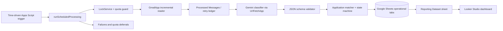

# Technical Design: Gmail Job Application Tracker

## Overview

Sistemul rulează exclusiv în cloud, ca proiect Google Apps Script instalat de utilizatorul autorizat. Un trigger time-driven pornește implicit orar, citește incremental mesajele Gmail eligibile, le clasifică prin Gemini API din Google AI Studio doar după acknowledgement de confidențialitate, păstrează evidența și jurnalul operațional în Google Sheets și publică datele curate pentru Looker Studio. Nu folosește Cloud Run, Pub/Sub, baze de date, servicii de cozi sau API-uri plătite.

Principii de design:
- **procesare at-least-once, efecte exactly-once**: un mesaj poate fi reluat, însă cheile persistente împiedică dublarea aplicațiilor și a istoricului;
- **minimizarea conținutului extern**: Gemini primește numai metadate și un extras limitat configurabil din corpul mesajului, fără atașamente;
- **conservator față de cote**: valorile de cotă nu sunt codificate permanent; utilizatorul le verifică și le salvează la configurare, iar operațiile sunt amânate înainte de depășire;
- **fără inferență riscantă**: legăturile ambigue nu schimbă statusul unei aplicații.

## Architecture



Un trigger instalabil Apps Script execută ca utilizatorul care l-a creat; prin urmare, citește numai mailbox-ul acelui utilizator și folosește cotele acelui cont. Triggerul pornește `runScheduledProcessing` la intervalul `schedule_interval_minutes` (60 implicit). Reconfigurarea intervalului șterge triggerul gestionat de tracker și creează unul nou; este intenționat să existe un singur trigger activ gestionat.

O execuție are patru faze delimitate: (1) achiziționarea lock-ului și verificarea cotelor, (2) selectarea/claim-ul mesajelor în ordine cronologică, (3) clasificarea și aplicarea idempotentă a efectelor, (4) upsert-ul dataset-ului de raportare și avansarea checkpoint-ului. Un `try/catch/finally` învelește execuția; o eroare necontrolată este scrisă printr-o operație de tip append în foaia `Processing_Failures`, izolată de scrierile stării normale.

Cercetarea a confirmat că trigger-ele time-driven suportă rulări periodice, cotele Apps Script sunt pe utilizator și fereastră de aproximativ 24 de ore, iar Gemini poate respecta un JSON Schema. Limitele actuale diferă după model/tier și sunt menținute configurabil, nu presupuse în cod. Surse: [Apps Script triggers](https://developers.google.com/apps-script/guides/triggers/installable), [Apps Script quotas](https://developers.google.com/apps-script/guides/services/quotas), [Gemini structured output](https://ai.google.dev/gemini-api/docs/structured-output), [Gemini rate limits](https://ai.google.dev/gemini-api/docs/rate-limits).

## Components and Interfaces

| Component | Responsibility | Boundary / interface |
|---|---|---|
| Trigger manager | Creează, găsește și înlocuiește triggerul orar; pornește run-ul. | Apps Script `ScriptApp`; nu creează trigger fără autorizarea Google. |
| Run coordinator | Lock global, identificator UUID de run, buget de timp, orchestration și failure boundary. | `runScheduledProcessing(): RunResult`; `LockService` previne rulări concurente. |
| Gmail incremental reader | Caută de la watermark cu fereastră de suprapunere, filtrează după message ID/ledger și extrage mesajele în ordine. | `GmailApp` read-only; produce `CandidateMessage[]`, nu marchează emailuri Gmail. |
| Processing ledger | Claim lease, încercări, răspuns Gemini salvat și finalizare. | Tab-ul `Processed_Messages`; unicitate logică pe `gmail_message_id`. |
| Quota guard | Compară bugetele/configurarea cu consumul estimat sau observat; înscrie deferări. | `canStart(operation, estimate)`, `recordUsage`, `defer`; fără apel extern când nu există buget. |
| Gemini client | Trimite un singur request per mesaj neclasificat, cu model Free Tier configurat. | `UrlFetchApp.fetch`; primește/salvează `ClassificationResult` JSON validat. |
| Matcher & state machine | Corelează mesajele, creează/updă aplicații, efectuează tranziții și istoricul. | Funcții pure testabile peste rânduri normalizate; scrieri Sheets idempotente. |
| Sheets repository | Citește și scrie în batch starea operațională și reconstruiește/upsert-ează raportarea. | `SpreadsheetApp`; niciun secret nu se păstrează în Sheet. |
| Looker Studio | Consumă numai `Reporting_Dataset`, cu refresh configurat în interfața Looker. | Conector Google Sheets read-only din perspectiva trackerului. |

Interfața administrativă poate fi un meniu Apps Script/funcții de setup în spreadsheet: `initializeTracker`, `configureSchedule`, `saveGeminiConfiguration`, `recordAcknowledgement`, `withdrawAcknowledgement`, `resolveRelationship`. Acestea sunt operații administrative manual invocate, nu endpoint-uri publice.

## Data Models

Fiecare tab are un rând de antet fix, stocat în același Google Spreadsheet. Datele de timp sunt ISO 8601 UTC (`*_at`), iar „Unavailable” este valoarea textuală afișată pentru date extrase inexistente; intern, absența este `null`. Identificatorii Gmail sunt păstrați ca text pentru a evita conversia numerică.

### `Applications` — sursa de adevăr, un rând per candidatură

| Column | Type / example | Rule |
|---|---|---|
| `application_id` | UUID | Cheie persistentă, creată o singură dată. |
| `dedup_key` | SHA-256 text | Cheie stabilă de confirmare: thread-ul inițial când este disponibil; altfel tuplu normalizat companie/rol/platformă/datǎ, numai dacă valorile sunt suficiente. |
| `initial_message_id`, `initial_thread_id` | text | Dovezi Gmail pentru confirmarea inițială. |
| `role`, `company`, `application_date`, `platform`, `location` | text/date | Din confirmare; lipsurile sunt `Unavailable`. Platforma se păstrează exact cum apare (ex. `LinkedIn`, `eJobs`). |
| `role_normalized`, `company_normalized`, `sender_domain_normalized` | text | Folosite exclusiv la matching; nu înlocuiesc valorile afișate. |
| `current_status` | enum | `Applied`, `Interview`, `Rejected`, `Offer`. |
| `applied_at`, `first_response_at`, `interview_at`, `rejected_at`, `offer_at`, `last_status_changed_at` | timestamp/null | Momente derivate din evenimente; `first_response_at` este primul follow-up corelat non-confirmare. |
| `created_at`, `updated_at`, `last_message_id` | timestamp/text | Audit și upsert idempotent. |

### `Status_History` — jurnal imuabil al evenimentelor de status

| Column | Type / example | Rule |
|---|---|---|
| `history_id` | UUID | Identificator persistent. |
| `event_key` | `status:<gmail_message_id>:<target_status>` | Cheie unică logică; împiedică duplicatele după crash/retry. |
| `application_id`, `source_message_id` | UUID/text | Referințe la aplicație și mesaj. |
| `previous_status`, `new_status` | enum/null | Pentru creare: `null` → `Applied`; pentru follow-up: statusul existent → statusul cerut. |
| `classification`, `changed_at`, `run_id` | enum/timestamp/UUID | Audit complet. |

Nu există un rând de istoric fără o aplicație existentă. O confirmare creează `null → Applied`; o confirmare deduplicată actualizează câmpurile lipsă/proveniența, dar nu retrogradează un status ulterior și nu adaugă din nou istoricul Applied.

### `Processed_Messages` — ledger de procesare și reluare

| Column | Type / example | Rule |
|---|---|---|
| `gmail_message_id` | text | Cheie unică logică; este înregistrată la claim, înainte de orice submit Gemini. |
| `gmail_thread_id`, `received_at`, `run_id` | text/timestamp/UUID | Proveniență și ordonare. |
| `state` | enum | `IN_PROGRESS`, `CLASSIFIED`, `COMPLETED`, `RETRYABLE_FAILURE`, `DEFERRED`, `UNRESOLVED`. Numai `COMPLETED`/`UNRESOLVED` sunt terminale. |
| `lease_expires_at`, `attempt_count`, `next_attempt_at` | timestamp/integer/timestamp | Un lease expirat face mesajul reeligibil; backoff-ul nu pierde mesajul. |
| `classification`, `classification_json`, `classification_hash` | enum/text/hash | Răspunsul validat se persistă înainte de scrieri de aplicație; reluarea îl reutilizează fără al doilea request. |
| `application_id`, `outcome`, `completed_at`, `last_error_id` | UUID/text/timestamp/UUID | Rezultat și legături de audit. |

`IN_PROGRESS` blochează același ID într-un run concurent. Dacă un run se întrerupe, lease-ul expiră; o reluare reia de la `CLASSIFIED` sau face un nou request doar când nu există JSON valid salvat. Astfel, faptul că un ID este „înregistrat” nu îl face procesat: doar o stare terminală îl exclude definitiv de la Gemini.

### `Processing_Checkpoint` și `Configuration`

`Processing_Checkpoint` are un singur rând activ cu `checkpoint_id`, `last_completed_received_at`, `last_completed_message_id`, `updated_at`, `last_run_id`. Watermark-ul avansează numai peste secvența cronologică contiguă de mesaje terminale; nu sare peste un mesaj eșuat/deferat. La citire se aplică o fereastră de suprapunere configurabilă (`overlap_minutes`, implicit 120) față de watermark, apoi ledger-ul elimină terminalele. Aceasta tolerează întârzieri de indexare Gmail și asigură că un mesaj incomplet rămâne după checkpoint și va fi reluat.

`Configuration` este un key/value auditat: `schedule_interval_minutes` (60 implicit), `max_messages_per_run`, `overlap_minutes`, `gemini_enabled`, `gemini_model_id`, `gemini_model_verified_at`, `gemini_free_tier_rpm`, `gemini_free_tier_tpm`, `gemini_free_tier_rpd`, `gemini_free_tier_daily_reset_reference`, `gemini_input_char_limit`, `execution_quota_gmail_reads`, `execution_quota_sheet_writes`, `execution_quota_runtime_minutes`, `execution_quota_verified_at`, `privacy_notice_version`, `privacy_acknowledged_at`, `privacy_acknowledged_by`, `privacy_withdrawn_at`, `config_updated_at`. Valorile de cotă sunt valorile publicate, verificate manual pentru cont/model; fiecare modificare adaugă și un rând în `Configuration_Audit` cu versiune, utilizator și timestamp.

Cheia Gemini nu apare în niciun tab; se introduce manual în **Script Properties** (`GEMINI_API_KEY`) și este accesibilă doar codului autorizat. `gemini_enabled` este efectiv doar când acknowledgement-ul curent este prezent și nu a fost retras.

### `Processing_Failures`, `Quota_Deferrals` și `Relationship_Exceptions`

`Processing_Failures`: `failure_id`, `run_id`, `gmail_message_id` nullable, `stage`, `reason_code`, `reason_detail_redacted`, `occurred_at`, `retryable`, `attempt_count`. Scrierea append se execută într-un `catch` separat; dacă nu se poate scrie, eroarea se loghează în execution log, fără a masca eroarea inițială.

`Quota_Deferrals`: `deferral_id`, `run_id`, `gmail_message_id` nullable, `operation` (`gmail_read`, `sheets_write`, `run`, `gemini_request`), `quota_name`, `estimated_units`, `observed_units`, `deferred_at`, `eligible_after`, `reason`, `resolved_at`. Se creează înaintea operației când estimarea ar depăși configurația și după un răspuns provider „quota exceeded”.

`Relationship_Exceptions`: `exception_id`, `gmail_message_id`, `classification`, `candidate_application_ids`, `evidence_summary`, `reason` (`NO_CANDIDATE`, `MULTIPLE_CANDIDATES`, `WEAK_MATCH`), `created_at`, `resolution` (`PENDING`, `LINKED`, `IGNORED`), `resolved_application_id`, `resolved_at`, `resolved_by`. Mesajele relevante necorelabile sunt terminalizate `UNRESOLVED`, păstrează această excepție și nu schimbă aplicațiile existente. Rezolvarea manuală poate aplica exact o tranziție idempotentă cu același `source_message_id`.

### `Reporting_Dataset` — tabel denormalizat pentru Looker Studio

Un upsert per `application_id`, efectuat în același run după modificarea aplicației/istoricului. Coloane: `application_id`, `current_status`, `role`, `company`, `application_date`, `platform`, `location`, `applied_at`, `first_response_at`, `interview_at`, `rejected_at`, `offer_at`, `last_status_changed_at`, `application_day`, `application_week_start`, `application_month`, `has_response`, `reached_interview`, `reached_offer`, `elapsed_to_first_response_hours`, `company_application_rank`, `dataset_updated_at`.

Câmpurile calculate permit: număr de aplicații pe zi/săptămână/lună, `response_rate = SUM(has_response)/COUNT(application_id)`, funnel pe indicatorii `reached_*`, distribuție platformă, clasament companie și media `elapsed_to_first_response_hours` ignorând valorile null. Dimensiunile pentru filtre sunt `current_status`, `role`, `company`, `application_date`, `platform`, `location`; calculul final de agregare/ranking poate fi realizat în Looker Studio pentru a respecta filtrele active.

## Operational Algorithms and Decision Rules

### Incremental processing, checkpoint și idempotency

1. Coordinatorul generează `run_id`, obține `LockService.tryLock` și verifică bugetul de runtime înainte de Gmail/Sheets. Un lock indisponibil produce un run scurt, fără modificări; nu pornește o a doua procesare.
2. Reader-ul citește Gmail de la `last_completed_received_at - overlap_minutes`, paginând thread-uri și descompunându-le în mesaje. Selectează numai mesajele ale căror perechi `(received_at, message_id)` sunt după checkpoint sau care au un rând nonterminal de retry; sortează ascendent după pereche. Fereastra de overlap nu reclasifică terminalele, deoarece ledger-ul este autoritatea pentru ID.
3. Pentru fiecare candidat, coordinatorul verifică din nou quota guard și face claim în `Processed_Messages` înainte de orice apel Gemini. Claim-ul este permis doar dacă nu există o stare terminală sau un `IN_PROGRESS` cu lease neexpirat. Se setează lease și `attempt_count` atomic în secțiunea protejată de lock.
4. Dacă există `classification_json` valid în starea `CLASSIFIED`, procesarea sare peste Gemini. Altfel, după toate gardurile, clientul trimite un request și persistă JSON-ul validat ca `CLASSIFIED` înainte de aplicație/istoric.
5. Repository-ul aplică upsert-uri în ordine: aplicație, eveniment `Status_History` căutat prin `event_key`, ledger terminal, apoi `Reporting_Dataset`. O reluare după orice întrerupere verifică fiecare cheie înainte de inserare; nu poate dubla efectul deja comis.
6. Mesajele `RETRYABLE_FAILURE` și `DEFERRED` păstrează `next_attempt_at`; checkpoint-ul nu le depășește. La final, watermark-ul avansează până la ultimul mesaj terminal contiguu; apoi se face un singur upsert al checkpoint-ului. `COMPLETED` înseamnă procesat, iar `UNRESOLVED` înseamnă procesat fără mutație de aplicație și cu excepție de corelare.

### Corelarea și mașina de stări

Pentru `Application_Confirmation`, căutarea unei aplicații existente urmează, în această ordine: (a) aceeași conversație `initial_thread_id`; (b) exact un `dedup_key` suficient; (c) exact un candidat cu companie și rol normalizate egale, platformă/date compatibile și dovadă de expeditor. O potrivire slabă sau mai multe potriviri nu creează automat un duplicat: se creează `Relationship_Exception` pentru rezolvare manuală. Dacă nu există candidat, se creează o aplicație și evenimentul `Applied`.

Pentru follow-up, regula cea mai puternică este existența unei aplicații a cărei `initial_thread_id` coincide cu thread-ul Gmail al mesajului. Fără aceasta, se calculează un scor explicabil doar din: companie normalizată, rol normalizat, domeniul expeditorului, platformă, proximitate temporală față de `applied_at` și identificatori citați în corp. Un candidat trebuie să depășească pragul configurat și să fie singurul cu scor maxim; egalitățile, lipsa candidatului sau dovada sub prag sunt `UNRESOLVED`. Rezumatul dovezii și lista candidaților se salvează, nu textul integral al emailului.

| Eveniment | Condiție | Efect |
|---|---|---|
| Confirmare nouă | Niciun candidat determinist | Creează aplicație `Applied`; adaugă `null → Applied`. |
| Confirmare duplicată | Un candidat determinist | Completează numai câmpuri lipsă/proveniență; păstrează statusul curent și istoricul. |
| `Interview_or_Test` corelat | Orice status curent | `current_status = Interview`; adaugă eveniment cu status anterior. |
| `Rejection` corelat | Orice status curent | `current_status = Rejected`; adaugă eveniment cu status anterior. |
| `Offer` corelat | Orice status curent | `current_status = Offer`; adaugă eveniment cu status anterior. |
| Follow-up necorelabil | Zero/multiple/slab | Creează excepție; fără modificare de aplicație sau istoric. |

Mesajele diferite pot înregistra tranziții succesive, inclusiv un nou status identic dacă reprezintă un eveniment distinct; același mesaj nu poate produce mai mult de un eveniment prin `event_key`. Pentru raportare, statusul curent este ultimul eveniment aplicat cronologic, iar evenimentele anterioare nu se șterg.

### Gemini: confidențialitate, JSON, cotă și retry

La configurare, administratorul selectează manual în Google AI Studio un `gemini_model_id` marcat în acel moment ca disponibil pe Free Tier, consultă documentația de limită/billing și introduce RPM, TPM/RPD aplicabile în `Configuration`. Trackerul nu activează facturare și nu presupune că vreun model rămâne gratuit; dacă eligibilitatea/limitele nu sunt verificate, clasificarea rămâne oprită. Notice-ul de acknowledgement va afirma explicit că text din mesaj este trimis către un serviciu extern (Gemini), că termenii și utilizarea datelor trebuie reverificați în documentația Google pentru tier-ul ales și că Free Tier nu stabilește singur caracterul privat al textului trimis. Notice-ul include legăturile către [billing](https://ai.google.dev/gemini-api/docs/billing), [rate limits](https://ai.google.dev/gemini-api/docs/rate-limits) și [Additional Terms](https://ai.google.dev/gemini-api/terms).

Înainte de primul request și înainte de fiecare request ulterior, `gemini_enabled` trebuie să fie adevărat, acknowledgement-ul trebuie să fie prezent după ultima retragere, iar guard-ul trebuie să aibă buget. `recordAcknowledgement` salvează versiunea notice-ului, identitatea utilizatorului și timpul. `withdrawAcknowledgement` scrie timpul retragerii, dezactivează efectiv clientul și lasă mesajele neprocesate/retryable fără a trimite conținut. Re-activarea cere un acknowledgement nou.

Request-ul `UrlFetchApp` folosește endpoint-ul Gemini GenerateContent pentru modelul configurat, `responseMimeType: application/json` și un JSON Schema strict. Conținutul include subiect, expeditor/domeniu, data și maximum `gemini_input_char_limit` caractere din corp normalizat; atașamentele, imaginile, adresele personale irelevante și istoricul integral al conversației nu sunt transmise. Schema cerută este echivalentă cu:

```json
{
  "type": "object",
  "additionalProperties": false,
  "required": ["classification", "role", "company", "applicationDate", "platform", "location", "evidence"],
  "properties": {
    "classification": {"type": "string", "enum": ["Application_Confirmation", "Rejection", "Interview_or_Test", "Offer", "Irrelevant"]},
    "role": {"type": ["string", "null"]},
    "company": {"type": ["string", "null"]},
    "applicationDate": {"type": ["string", "null"]},
    "platform": {"type": ["string", "null"]},
    "location": {"type": ["string", "null"]},
    "evidence": {"type": "object", "additionalProperties": false, "required": ["confidence", "excerpt"], "properties": {"confidence": {"type": "number", "minimum": 0, "maximum": 1}, "excerpt": {"type": "string", "maxLength": 500}}}
  }
}
```

Aplicația parsează răspunsul și validează local enum-ul, câmpurile obligatorii, tipurile, datele și absența proprietăților suplimentare. Un JSON invalid, răspuns gol sau clasificare nepermisă produce `Processing_Failure` retryable și nu modifică aplicații. Fiecare request acceptat are exact o clasificare enum; nu se acceptă text liber ca fallback.

Guard-ul estimează cereri și tokeni din lungimea extrasului, păstrează contoare pe ferestre configurate și rezervă buget înainte de submit. Dacă estimarea depășește o limită stocată, creează `Quota_Deferral` înainte de apel și setează `eligible_after` la următoarea fereastră configurată. Pentru erori tranzitorii/429/5xx, aplică maximum un număr configurabil de retry-uri în aceeași execuție cu backoff exponențial și jitter, numai cât permite timpul rămas și quota guard; apoi deferă. Pentru 401/403, model indisponibil sau acknowledgement absent, nu mai trimite și înregistrează failure ne-retryable până la intervenție administrativă. Un răspuns Google de tip quota-exceeded pentru Gmail, Apps Script sau Sheets este normalizat ca `Quota_Deferral`, iar mesajul rămâne nonterminal.

## Correctness Properties

*A property is a characteristic or behavior that should hold true across all valid executions of a system—essentially, a formal statement about what the system should do. Properties bridge human-readable specifications and machine-verifiable correctness guarantees.*

### Reflection on the properties

Prework-ul a identificat tranzițiile Interview/Rejected/Offer ca aceeași regulă parametrizată, astfel sunt o singură proprietate de mașină de stări. Regulile de cotă Gemini și Google au aceeași interdicție fundamentală de „nu apela când bugetul/consimțământul interzice”; sunt consolidate, păstrând aserțiuni separate pentru deferare și reluare. Invariantul „nu crea istoric fără aplicație” este inclus în proprietatea de creare/tranziție; nu are valoare independentă. Se păstrează proprietăți diferite pentru selecție, validare, corelare ambiguă, idempotency și reporting deoarece niciuna nu este implicată logic de cealaltă.

### Property 1: Failures remain independently auditable

For any injected processing-stage exception and run timestamp, the coordinator records exactly one `Processing_Failure` with that run/timestamp and a reason, even when the normal state write is unavailable.

**Validates: Requirements 1.4, 2.4, 3.4**

### Property 2: Incremental selection processes each eligible message once

For any ordered Gmail message set, checkpoint, overlap window, and ledger states, the planned Gemini submissions contain every eligible nonterminal retry/candidate after the contiguous watermark at most once, and contain no terminal processed message ID.

**Validates: Requirements 2.1, 2.3, 2.4, 6.4**

### Property 3: Classification contract is strict and non-mutating on invalid data

For any Gemini response body, local validation accepts it only when it is a conforming JSON object with exactly one allowed classification and valid structured fields; every rejected body produces no application/history mutation and leaves its message retryable.

**Validates: Requirements 3.1, 3.4**

### Property 4: Irrelevant and incomplete data are safely normalized

For any `Irrelevant` classification and existing application state, completion creates no application/history changes; for any relevant structured result, every absent display field becomes `Unavailable` and every extracted platform value is preserved exactly.

**Validates: Requirements 3.2, 4.1, 4.2, 4.3**

### Property 5: Confirmation creation is unique and auditable

For any sequence of confirmations with deterministic correspondence, processing creates exactly one stable application per distinct application key, never regresses a later status on duplicate confirmation, and each newly created application has exactly one `null → Applied` source-message event.

**Validates: Requirements 3.3, 4.4, 4.5, 4.6, 6.1, 6.2, 6.3**

### Property 6: A uniquely linked follow-up produces one prescribed transition

For any application, prior status, uniquely linked follow-up, and target classification in `{Interview_or_Test, Rejection, Offer}`, processing sets respectively `Interview`, `Rejected`, or `Offer` and appends exactly one event preserving the prior status, new status, message ID and timestamp.

**Validates: Requirements 5.1, 5.2, 5.3, 5.4, 6.3**

### Property 7: Ambiguity is non-destructive

For any relevant follow-up whose candidates are absent, tied, or below threshold, processing records one unresolved relationship containing its message ID and leaves all applications and status-history entries unchanged.

**Validates: Requirements 5.5, 4.6**

### Property 8: Replay has exactly-once domain effects

For any completed message and any positive number of subsequent submissions or crash-recovery resumes, the resulting applications, application count, status-history event keys and history count equal the result of the first completed processing.

**Validates: Requirements 2.2, 6.4, 6.5**

### Property 9: Authorization and quota guards prevent prohibited submission and preserve retries

For any candidate, acknowledgment state, free-tier/execution-quota window, estimated operation cost, and recognized quota error, if acknowledgement is absent/withdrawn or any required budget is unavailable then no prohibited provider call or content submission occurs, exactly one deferral is recorded where quota-caused, and the message remains nonterminal until a later eligible window permits retry.

**Validates: Requirements 7.3, 7.4, 7.5, 7.7, 7.10, 10.2, 10.3, 10.4, 10.5**

### Property 10: Reporting is a faithful one-row projection

For any valid applications and histories, projection produces exactly one reporting row per application, preserves all required filter dimensions and timestamps, and its day/week/month buckets, response/funnel flags and elapsed-time values equal a simple reference calculation.

**Validates: Requirements 8.1, 8.3, 8.4**

## Error Handling

| Condition | Action | Persistent outcome |
|---|---|---|
| Lock indisponibil / runtime insuficient | Încheie înainte de Gmail; nu suprapune run-uri. | Failure/deferrare de run când este cauzată de cotă; checkpoint neschimbat. |
| Gmail search/read eșuat | Nu marchează mesajul terminal; capturează codul redacționat. | `RETRYABLE_FAILURE` sau `Quota_Deferral`; reia ulterior. |
| Gmail/Apps Script/Sheets quota exceeded | Oprește operația afectată, nu încearcă să „forțeze” cota. | O `Quota_Deferral`, mesaje nonterminale, retry la fereastra următoare. |
| Sheets write eșuează după `CLASSIFIED` | Nu cere din nou Gemini dacă JSON valid a fost salvat. | Failure retryable; resume aplică numai upsert-urile lipsă. |
| Eroare rețea Gemini / 429 / 5xx | Retry bounded cu backoff/jitter doar în timp și buget; altfel deferă. | Failure/deferral și `next_attempt_at`. |
| Cheie/model invalid, 401/403, model fără verificare Free Tier | Blochează clientul până la corecție manuală; nu degradează spre alt model. | Failure ne-retryable, fără submit nou. |
| JSON Gemini invalid | Nicio mutație de domeniu. | Failure retryable, mesaj eligibil ulterior. |
| Corelare neclară | Nicio presupunere și nicio tranziție. | `Relationship_Exception`, `UNRESOLVED` terminal până la rezolvare manuală. |
| Acknowledgement retras | Oprește imediat planificarea de conținut Gemini. | Timp de retragere în config/audit; mesaje păstrate neprocesate. |
| Eroare neașteptată de run | `finally` eliberează lock; `catch` face append independent. | Un `Processing_Failure` cu `run_id`, timp și motiv redacționat. |

Logurile nu includ corp complet de email, cheie API sau header-uri sensibile. Mesajele de diagnostic păstrează ID-uri, stadii și coduri; `reason_detail_redacted` trunchiază/maschează datele personale.

## Testing Strategy

PBT este adecvat numai pentru stratul local/pur: normalizarea și validarea JSON, selecția ledger/checkpoint, scoring-ul de corelare, tranzițiile, idempotency, deciziile de cotă și proiecția raportării. Se va folosi biblioteca standard de PBT a limbajului Apps Script/JavaScript ales (de exemplu `fast-check`, integrată prin procesul de build/test al proiectului), nu o implementare proprie. Fiecare dintre proprietățile 1–10 are **un singur test PBT**, minimum **100 de iterații**, generatori care includ unicode, lipsuri, duplicate, egalități de scor și granițe de timp/cotă. Fiecare test va conține comentariul: `Feature: gmail-job-application-tracker, Property N: <property text>`.

Teste unitare/example, cu Gmail/Gemini/Sheets/clock mock-uite:
- claim-ul este scris înaintea submit-ului (2.2), persistența configurației/modelului/cotelor și auditului (7.2, 7.11, 10.1), textul complet al notice-ului (7.6, 7.8, 7.9), plus schema/câmpurile raportării (8.5);
- fixture-uri redacționate pentru extragerea semantică Gemini (4.1), inclusiv LinkedIn/eJobs, date absente, mesaje în același thread și corpuri malformate;
- teste de recovery care întrerup după fiecare pas de commit și verifică proprietatea 8 cu repository Sheets mock.

Teste de integrare într-un cont Google de test, cu mesaje/foi sintetice și fără date personale:
- inițializare Apps Script, autorizări, trigger implicit și schimbarea intervalului (1.1–1.3);
- rulare Gmail read-only pe label/query de test, restart după failure și verificarea checkpoint-ului (2.1–2.4);
- un request Gemini autorizat către modelul Free Tier verificat manual, apoi un caz 429/simulare de limită (3.1, 7.1, 7.3–7.5);
- commit Sheets + `Reporting_Dataset` înainte de finalizarea run-ului (8.2);
- Looker Studio conectat la fixture: source, grafice de zi/săptămână/lună/KPI/funnel/distribuție/ranking, tabel, filtre și refresh (9.1–9.5).

Smoke/manual acceptance înainte de activare: confirmarea modelului/tier-ului și a limitelor curente Google, confirmarea că nu este atașat un cont de billing pentru acest flux, verificarea notice-ului înainte de acknowledgement, existența unui singur trigger, accesul Looker doar la `Reporting_Dataset` și așteptarea refresh-ului configurat. Aceste verificări sunt necesare deoarece platformele Google și Looker sunt externe și nu devin mai sigure prin 100 de execuții automate.

### Manual Google-account configuration (required)

1. Creează un Google Spreadsheet privat, instalează proiectul Apps Script legat de el, rulează inițializarea și acordă explicit permisiunile Gmail read-only necesare, Sheets și external requests. Selectează contul Gmail care trebuie urmărit; triggerul rulează ca acest utilizator.
2. În Google AI Studio creează cheia API pentru proiectul/contul eligibil, verifică în documentația oficială modelul Free Tier și limitele curente, apoi salvează cheia în Script Properties și modelul/limitele/timestamp-ul în foaia de configurare. Nu conecta billing pentru această soluție gratuită.
3. Citește notice-ul de prelucrare externă și înregistrează acknowledgement-ul numai dacă accepți trimiterea extraselor de email către Gemini. Poți retrage acknowledgement-ul; aceasta oprește imediat submit-urile ulterioare.
4. Creează/autorizează triggerul instalabil implicit de 60 minute (sau un interval permis ales) și revizuiește periodic cotele/termenii Google, actualizând valorile stocate când se schimbă.
5. În Looker Studio, creează manual o sursă Google Sheets care indică exclusiv tab-ul `Reporting_Dataset`, construiește graficele și filtrele cerute și configurează refresh-ul disponibil în acel cont. Apps Script actualizează foaia; nu controlează direct frecvența de refresh Looker Studio.

Content from the linked sources was rephrased for compliance with licensing restrictions.
